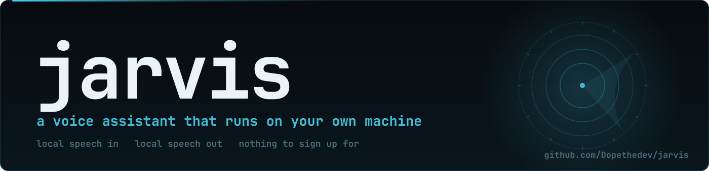

<p align="center">
  
</p>

<p align="center">
  <a href="https://github.com/Dopethedev/archy/actions/workflows/tests.yml"></a> <a href="https://github.com/Dopethedev/archy/releases"></a>   
</p>

**Archy is a voice assistant that runs on your own machine.** Say the wake phrase, ask
something, hear the answer. It also reads your screen, sets reminders, briefs you,
sweeps the machine for anything odd, and drives a dashboard that changes mood by
voice.

Everything that hears and speaks is local: silero for voice activity,
faster-whisper for speech to text, kokoro for speech out. Only the thinking goes
to a model, through a local [`pi`](https://github.com/badlogic/pi-mono) process,
so the model is whichever one you point it at.


## Install

```
git clone https://github.com/Dopethedev/archy archy && cd archy
uv sync
uv run python -m archy.fetch_models     # the voice models, 340 MB, all free
./run.sh                                 # say the wake phrase, then ask
```

Windows uses `run.cmd`; macOS uses the same `./run.sh`. The first run asks for the
Microphone permission and the first screen question asks for Screen Recording,
both under System Settings, Privacy and Security. A terminal that was refused has
to be started again after the tick.

`fetch_models` also takes `--check` (report without fetching), `--all` (add the
fallback voice) and `--force`. Whisper downloads its own model on the first
question.

## What it does

- **Voice loop.** Wake phrase, request, answer, idle. The phrase is recognised, so
  any phrase works and a request can ride along with the wake word.
- **Interruption.** Talk over it, or say the phrase again, and it stops mid
  sentence.
- **It can look and check.** Screen vision, and a security sweep over processes,
  listeners, SSH, hosts file, world writable paths, user services, browser
  extensions, launchers, pending updates.
- **It can report and remember.** A local briefing, reminders and timers parsed on
  the machine, durable memory, themes, and a model chain that moves on when a relay
  stalls. Windows it can list and bring forward, without the model guessing.

The full list, including the limits, is in [FEATURES.md](FEATURES.md).

## Numbers from actual runs

| | |
|---|---|
| speech in, whisper `base.en` | 0.48 s for an utterance |
| speech out, kokoro | 1.10 s to make 4.10 s of speech |
| a reminder, a timer, a theme change | about 0.6 s, no model involved |
| resident memory while running | about 1.2 GB |

## Themes

| standard | stealth | combat |
|---|---|---|
|  |  |  |

Say "combat mode" by voice, or open the page with `?theme=combat`.

## What leaves this machine

- **What you said**, as text, because that is the question. The audio never goes.
- **A picture of your screen**, only when you ask about it. Wayland and Windows
  keep it in memory; macOS writes one file and removes it in the same breath.
- **The local facts** you asked for: a briefing or a sweep.
- **What it remembers about you**, and **a weather lookup** to open-meteo. No key.

The default chain is free public relays, so a third party sees your text. Point
`pi` at a model you pay for, or one running here, and that stops being true.

## Requirements

A microphone, **[`pi`](https://github.com/badlogic/pi-mono) on `PATH`**, and
**Python 3.12** (`uv` handles it: ctranslate2 has no wheels past it). **Linux** with
PipeWire, **macOS** for everything, **Windows** for everything except the sweep.

Optional, per feature, each reported as skipped rather than as a clean machine:

- `grim` and `ffmpeg` for screen questions on Wayland (`screencapture` on macOS).
- `clamscan` for the virus scan, `lynis` for the deeper audit, and `rkhunter` for the
  rootkit check, which is root only on Arch, so the sweep says it could not run.
- `niri`, `hyprctl` or `swaymsg`, whichever compositor you run, for "focus the
  browser". A desktop Archy does not recognise gets one honest sentence.

Arch: `pacman -S pipewire grim ffmpeg clamav lynis rkhunter`, and Debian the same
names through `apt install libportaudio2 pipewire grim ffmpeg clamav lynis rkhunter`.

## Your own settings

`config.py` holds every tunable and nothing personal. Copy
`config.local.example.json` to `config.local.json` (gitignored) and set
`USER_NAME`, `CITY`, `LATITUDE`, `LONGITUDE`, `WAKE_PHRASE`, `WAKE_ALIASES` and
`WHISPER_HINT_EXTRA`.

`WHISPER_HINT_EXTRA` and `WAKE_ALIASES` are worth filling in: the phrase is
recognised, not matched, and whisper will not spell an unseen name the same way
twice. The phrase and its last word are always honoured; the aliases are the
variants it invents on top. Anything left out falls back to a default.

### Windows and `PI_BIN`

Windows has no `pi.exe`, only the `pi.cmd` and `pi.ps1` shims npm installs. Both
run through `cmd.exe`, which re-parses the command line before node sees it. The
system prompt Archy passes carries quotes (the memory instruction reads
`NAME "VALUE"`), so through those shims the argument comes apart and pi treats it
as a file path. The request then arrives far over the limit and the relay refuses
it.

Set `PI_BIN` in `config.local.json` to a program that passes its arguments through
unparsed. A small shim does it: quote the arg list the way the C runtime does and
spawn node with the pi CLI bundle, letting rpc mode speak over stdin, stdout and
stderr unchanged. Point `PI_BIN` at the npm `.cmd` and it fails the way described
above.

One more trap on the same platform: with stdio inherited and not explicitly
redirected, a spawned child lands on a hidden console, where its output goes
nowhere and its stdin never ends. The shim has to create the pipes and relay the
bytes itself, or pi runs, says nothing, and Archy reports the connection dropped.

## Commands

```
./run.sh                 voice loop, dashboard in its own window
./run.sh --no-hud        console only
./run.sh --say "hi"      one typed message, no microphone
./run.sh --mic-test      live microphone check: level, speech score, transcript
./run.sh --input Fifine  pick an input device by name
./tests/run_all.sh       every check that needs no microphone
```

## Layout

```
src/archy/   the assistant, one module per part, named for what it does
hud/          the dashboard page, served as static files, so no build step
tests/        one file per behaviour, none needing a microphone
docs/         the banner, the demo, the theme screenshots, and the scripts that draw them
run.sh        the launcher for Linux and macOS, and run.cmd for Windows
```

## Contributing

See [CONTRIBUTING.md](CONTRIBUTING.md): a test that cannot fail does not count,
numbers come from runs, failure paths first, personal settings never in a tracked
file, and the suite runs on Linux, macOS and Windows in the workflow behind the
badge at the top. An AI assistant did most of the typing here, from my direction
and against this machine.

## Licence

MIT, see [LICENSE](LICENSE). Not everything it uses is MIT:

- faster-whisper, kokoro-onnx, onnxruntime, sounddevice and Pillow are MIT;
  openwakeword is Apache-2.0; numpy is BSD; **soxr is LGPL-2.1-or-later**.
- **piper-tts is GPL-3.0-or-later** and is only the fallback voice: `uv sync
  --extra fallback-voice` adds it and nothing else does. The code runs the `piper`
  program as a separate process rather than importing it.
- The voice models keep the terms of whoever published them, and the thinking is a
  model behind the relay you configure, with its own terms.
