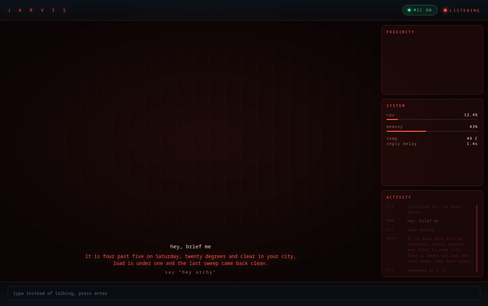
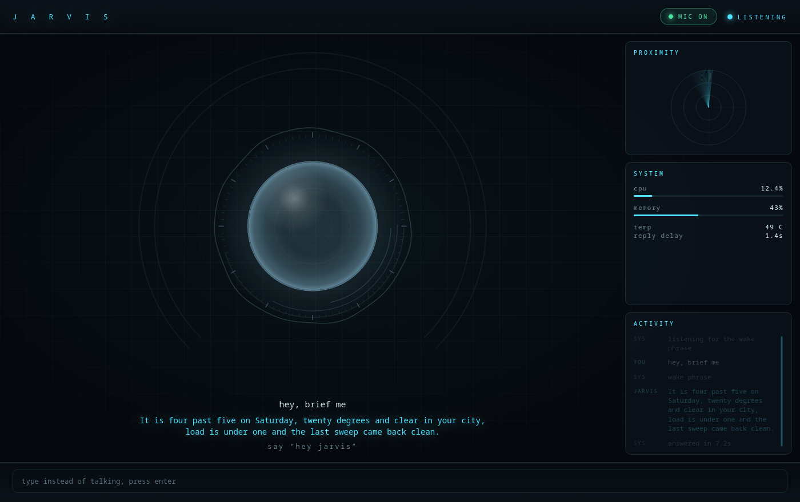
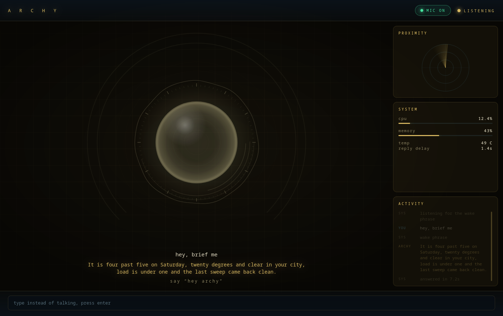

# jarvis

[](https://github.com/Dopethedev/jarvis/actions/workflows/tests.yml)

A voice assistant that runs on your own machine. Say the wake phrase, ask
something, hear the answer. It can also look at your screen, set reminders, read
you a morning briefing, sweep the machine for anything odd, and drive a
dashboard that changes mood by voice.

Everything that hears and speaks runs locally: silero for voice activity,
faster-whisper for speech to text, kokoro for speech out. Only the thinking goes
to a model, through a local `pi` process.



The dashboard ships with three themes, switchable by voice. It repaints the orb,
the rings, the radar and every panel:

| standard | stealth | combat |
|---|---|---|
|  |  |  |

## What it does

- **Voice loop.** Wake phrase, request, answer, back to idle. The phrase is
  recognised rather than matched against a trained model, so any phrase works
  and a request can arrive in the same breath as the wake word.
- **Interruption.** Talk over it, or say the phrase again, and it stops mid
  sentence. It also gives up on a slow model if you start talking.
- **Typed input.** The dashboard has a text box, for when the microphone is not
  the right tool.
- **Screen vision.** Ask about what is on screen and it takes a screenshot and
  looks at it.
- **Security sweep.** One request runs a set of checks over the machine:
  processes, listeners, SSH, host file, world writable paths, user services,
  browser extensions, launchers, pending updates, and a ClamAV scan of the usual
  drop points. It reports what is normal as well as what is not.
- **Briefing.** Time, date, weather, machine load, memory, uptime, and how the
  last sweep went. Gathered locally, before the model is asked anything.
- **Reminders and timers.** "Remind me in twenty minutes to check the oven."
  Parsed locally, so it is confirmed in under a second, and spoken when due.
- **Themes.** Three dashboard themes, switched by voice.
- **Memory.** Durable facts in a file you can read and edit by hand, handed to
  the model on every turn so remembering costs no round trip.
- **A model chain.** Free relays die without warning. If the first one stops
  answering, the next takes over and it says so.
- **A microphone switch.** Off means off, from the dashboard or a key, and it
  stays off across a restart.

The full list, including what is limited and what is deliberately not here, is
in [FEATURES.md](FEATURES.md).

## What leaves this machine

Everything that hears and speaks is local, so this is the short list of what does
not stay:

- **What you said**, as text. The transcript goes to the model, because that is
  the question. The audio itself never does.
- **A picture of your screen**, only when you ask something about what is on it,
  and only as a JPEG in memory. Nothing is written to disk.
- **The local facts**, when you ask for a briefing or a sweep: the time, the
  weather line, the machine readings and the last sweep report go into the prompt
  as context.
- **What it remembers about you**, since the stored facts are given to the model
  on every turn.
- **The weather lookup**, which asks open-meteo for your coordinates. Plain DNS
  and HTTP from your machine to theirs, no key, no account.

Where it all goes is whichever model `pi` is pointed at, and that is worth being
plain about: the default chain here is free public relays, so a third party sees
your text. Point it at a model you pay for, or one running on this machine, and
that stops being true. The dashboard never leaves the machine: it listens on
localhost and refuses anything without its token.

## Requirements

- Linux with PipeWire, a microphone and headphones. Written and used on Arch and
  Hyprland; the voice loop is not tied to a desktop, but the security sweep is
  (it asks `pacman` what owns a file, and reads Brave's profiles).
- Linux or Windows. The way of looking at the screen is picked by what the
  machine has: grim and ffmpeg on Wayland, Pillow anywhere else. The one part
  that is Linux only is the security sweep, which reads `/proc`, systemd, the
  package manager and browser profiles; asked for one on Windows it says so
  instead of pretending. The microphone-free half of the suite, which is most of
  it, is run on both by the workflow above.
- Python 3.12. `uv` handles that, and ctranslate2 has no wheels past 3.12.
- [`pi`](https://github.com/badlogic/pi-mono) on `PATH`, which is where the
  model connection lives.
- For screen vision: `grim` and `ffmpeg`. Without them it says it cannot see.
- For the ClamAV part of the sweep: `clamav`. The other checks that need a tool
  it does not have are skipped and reported as skipped, not as clean.

## Install

```
git clone https://github.com/Dopethedev/jarvis jarvis && cd jarvis
uv sync
```

On Windows the same two commands work in PowerShell or a command prompt, and
`run.cmd` is the launcher:

```
git clone https://github.com/Dopethedev/jarvis jarvis; cd jarvis
uv sync
run.cmd
```

Windows needs nothing extra for the screen: it takes a frame through Pillow.
ffmpeg is only needed on Wayland, and grim with it.

Then the models, which are not in the repository and are all free:

```
uv run python -m jarvis.fetch_models
```

That fetches the voice (`kokoro-v1.0.onnx`) and its accents (`voices-v1.0.bin`)
from the `kokoro-onnx` release `model-files-v1.1`, copies the voice activity
detector (`silero_vad.onnx`) out of the openWakeWord package that is already
installed, then opens each file the way the assistant opens it, because a file
that is present is not the same as a file that loads. Anything already in place
is left alone; `--check` says what is here without fetching; `--all` adds the
optional piper fallback voice.

Two more arrive on their own. Whisper downloads its model into the huggingface
cache the first time it answers, about 140 MB, and the wake phrase model is
already inside openWakeWord.

## Running it

```
./run.sh                 voice loop, dashboard in its own window
./run.sh --no-hud        console only
./run.sh --say "hi"      one typed message, no microphone
./run.sh --mic-test      live microphone check: level, speech score, transcript
./tests/run_all.sh       every check that needs no microphone
```

`./run.sh --input Fifine` picks an input device by name.

## Your own settings

`config.py` holds every tunable and nothing personal. Copy the example and fill
in yours:

```
cp config.local.example.json config.local.json
```

```json
{
  "USER_NAME": "your name",
  "CITY": "your city",
  "LATITUDE": 0.0,
  "LONGITUDE": 0.0,
  "WHISPER_HINT_EXTRA": "your name, your town, the programs you launch by voice",
  "WAKE_PHRASE": "hey jarvis",
  "WAKE_ALIASES": ["jarvis", "jervis"]
}
```

`WAKE_ALIASES` is worth filling in when you pick an unusual name: the phrase is
recognised, not matched against a trained model, and whisper will not spell a
name it has never seen the same way twice. The phrase itself and its last word
are always honoured; the aliases are the variants it invents on top of those.

That file is gitignored. Anything you leave out falls back to a sane default: no
location means the briefing says the weather is unavailable rather than guessing,
and the wake phrase stays `hey jarvis`.

## Layout

```
src/jarvis/
  config.py         every tunable, nothing else stores settings
  audio.py          microphone capture and speaker playback
  wake.py           wake phrase detection, by recognition or a trained model
  vad.py            is this frame speech, on onnxruntime directly
  stt.py            speech to text
  tts.py            text to speech
  brain.py          the pi process and its rpc protocol
  assistant.py      the state machine and the audio pump
  sweep.py          the security checks
  briefing.py       time, weather, machine health, last sweep
  reminders.py      reminders and timers
  vision.py         screenshots for the model
  memory_store.py   durable facts, readable by hand
  hud.py            the dashboard server, the mic switch, the typed input
  mictest.py        the live microphone check
run.cmd             the launcher for Windows, where there is no bash
hud/                the dashboard page
docs/               theme screenshots, and the script that renders them
tests/              one file per behaviour, all runnable without a microphone
```

`hud/` (the page) sits beside the package rather than inside it, because it is
served as static files: no build step, no external assets, no framework.
`docs/render-screenshots.sh` regenerates the images above against a fake event
stream, so they need no live assistant. The start-up reset of the activity log,
the mic switch and the boot film are all in `hud/app.js`.

## What is deliberately not here

Email is the obvious one. It is not included because reading someone's mail
means shipping their credentials somewhere and sending their messages to a model,
and that is a decision each person should make for themselves rather than inherit
from a repository. It is also about eighty lines: an IMAP fetch, a local intent
beside the ones in `assistant.py`, and the password in `config.local.json`.

The same goes for anything that needs an account, a key you pay for, or a
service that can change its mind: calendar, home automation, music control. The
seams for all of them already exist, because a request is either answered
locally, where `reminders` and the theme switch live, or handed to the model with
its tools. Bring your own account and keep it in `config.local.json`.

## Contributing

See [CONTRIBUTING.md](CONTRIBUTING.md). It is short, and it says what this
repository actually does: a test that cannot fail does not count, numbers come
from runs, failure paths first, and personal settings never in a tracked file.

## How this was made

Written with an AI assistant doing most of the typing, from my direction and
against this machine: a real microphone in a real room, a real screen, and a test
suite that had to be able to fail before it was allowed to pass. The commit
messages keep the parts that were wrong at first, including the reasons, which is
the half of the story that is usually thrown away.

## Tests

```
./tests/run_all.sh
```

Each file is a behaviour, not a unit: the audio pump, the wake phrase shapes,
the sweep's browser checks, the reminder grammar, the model chain failing over,
the dashboard's own security. They run without a microphone and without a model,
except two that talk to `pi` on purpose.

## Licence

MIT, see [LICENSE](LICENSE).

What it uses is not all MIT, which is worth knowing before you ship it:

- faster-whisper, kokoro-onnx, onnxruntime, sounddevice and Pillow are MIT;
  openwakeword is Apache-2.0; numpy is BSD; **soxr is LGPL-2.1-or-later**.
- **piper-tts is GPL-3.0-or-later** and is only the fallback voice. The code does
  not import it: it runs the `piper` program as a separate process, which is what
  keeps the two apart.
- The voice models carry the terms of whoever published them: the Kokoro weights
  are Apache-2.0, Silero VAD is MIT, and Whisper and the Piper voices have their
  own pages, linked in the model table above.
- The thinking is not in this repository at all. It is a model behind the relay
  you configure, with its own terms and its own view of what you send it.

MIT. See `LICENSE`.
